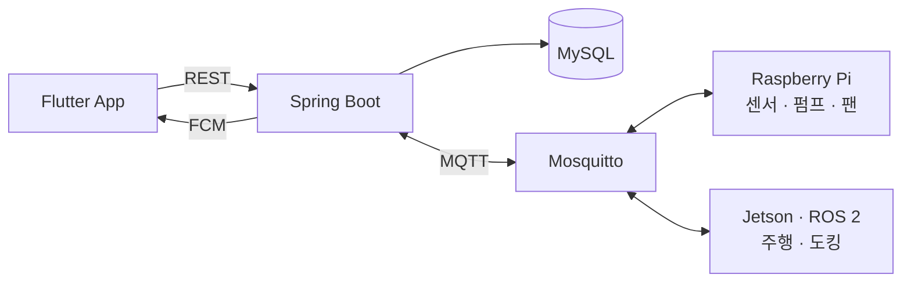

# PotneR · 이동형 스마트 화분

> Pot + Partner. 식물 생육 환경을 스스로 돌보는 반려식물 로봇입니다.

센서로 토양 수분·조도·온습도를 모으고, 수분이 부족하면 로봇이 급수 스테이션으로 이동해 물을 주고 송풍한 뒤 대기 장소로 돌아옵니다. Flutter 앱에서는 식물의 상태와 환경 그래프, 성장 일기와 사진 기록을 확인합니다.

- 삼성청년 SW·AI아카데미(SSAFY) 15기 공통 프로젝트 · **우수상**
- 기간 2026.07 ~ 2026.08 · 6인 팀(E104 친구사이)
- 영상 포트폴리오: https://www.youtube.com/watch?v=JgmYadg7w9M

## 저장소 구성

SSAFY GitLab에서 파트별 브랜치로 관리하던 코드를 폴더로 합쳤습니다. 각 폴더의 커밋 기록은 원래 브랜치의 기록을 그대로 옮긴 것입니다.

| 폴더 | 내용 | 원래 브랜치 |
| --- | --- | --- |
| [`app/`](app) | Flutter 앱 — 식물·센서·성장 기록 화면, 장치 제어, 푸시 알림 | `App-develop` |
| [`server/`](server) | Spring Boot 백엔드 — 인증, 센서 수집, 자동 케어, 일기 생성, 배포 설정 | `Server-master` |
| [`robot/`](robot) | Jetson · ROS 2 — 자율 주행, 도킹, 로봇 대화 | `Robot-develop` |
| [`raspberry/`](raspberry) | Raspberry Pi — 온습도·조도·토양 수분 수집기 | `Raspberry-develop` |
| [`jupyter/`](jupyter) | YOLO 기반 식물 성장 단계 탐지 실험 | `Jupyter-develop` |

각 폴더의 README에 실행 방법과 세부 설계가 있습니다. 서버 구현은 [`server/docs/BACKEND.md`](server/docs/BACKEND.md)에 정리되어 있습니다.

## 시스템 구성

- 서버는 장치 명령을 DB에 저장하고 커밋한 뒤 MQTT로 발행합니다. 장치 회신은 requestId·장치·명령 종류로 대조하고, QoS 1 재전송은 messageId로 걸러냅니다.
- 자동 급수는 `수분 부족 → 스테이션 이동 → 급수 → 송풍 → 복귀` 순서로, 완료된 명령을 기준으로 다음 단계를 이어 갑니다.
- Jenkins로 테스트·빌드·배포하고, 배포 후 Health Check가 실패하면 이전 이미지로 되돌립니다.

## 기술 스택

| 영역 | 기술 |
| --- | --- |
| App | Flutter, Riverpod, go_router, Dio, Firebase Cloud Messaging |
| Backend | Java 21, Spring Boot, Spring Security, JPA, Flyway, MySQL |
| Messaging | Mosquitto MQTT |
| Device | Raspberry Pi, Jetson, ROS 2, Python |
| Infra | Docker Compose, Nginx, Jenkins |

## 팀

| 이름 | 주로 작업한 폴더 (커밋 기준) |
| --- | --- |
| 서영석 | `app/`, `server/` — Flutter 앱, 백엔드, 배포 |
| jedabin | `robot/` |
| 공병우 | `raspberry/`, `robot/` |
| 정송하 | `app/` |
| 주소정 | `app/`, `server/` |
| 한동규 | `jupyter/`, `robot/` |

## 참고

- Android 빌드에는 Firebase 설정 파일 `app/android/app/google-services.json`이 필요합니다. 공개 저장소에는 포함하지 않았으니 각자의 Firebase 프로젝트에서 받아 넣어 주세요.
- 배포 서버 주소, 계정 정보 같은 민감한 설정은 환경 변수로 주입하며 저장소에 포함하지 않습니다.
