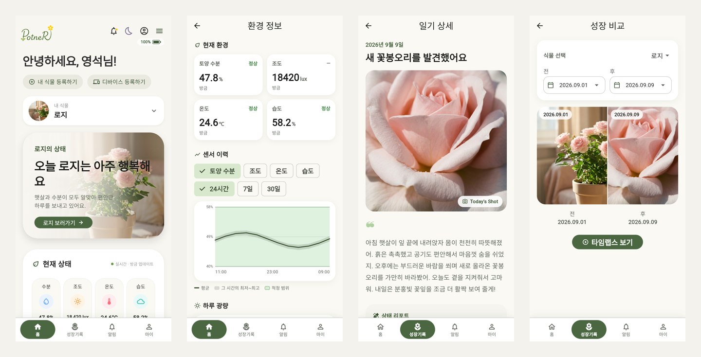
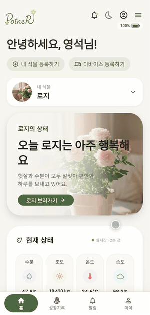
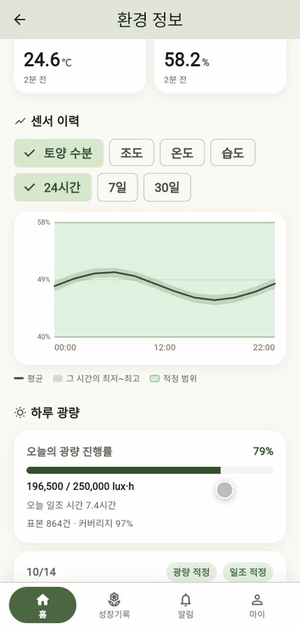
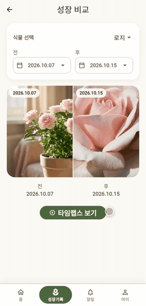
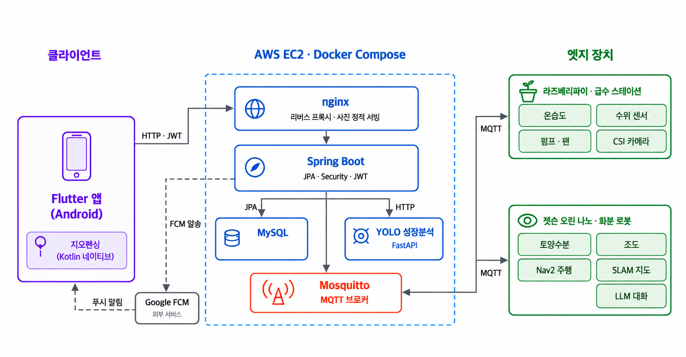

# PotneR · 식물 생육 환경을 스스로 돌보는 이동형 스마트 화분

> Pot + Partner. 센서 상태를 바탕으로 로봇의 급수·환기·일조량 관리를 자동화하고, Flutter 앱에서 식물의 상태와 성장 기록을 확인하는 IoT 서비스입니다.

<p align="center">
  
</p>
<p align="center"><sub>Flutter 앱 화면 — 홈 · 환경 정보 · 성장 일기 · 성장 비교 (프로젝트 종료 후 시연용 데이터로 다시 녹화)</sub></p>

| 기간 | 팀 구성 | 내 역할 | 수상 |
| --- | --- | --- | --- |
| 2026.07 ~ 2026.08 | 6인 팀 (SSAFY 15기 공통 프로젝트) | Flutter App · Backend · Infra | 삼성청년 SW/AI 공통프로젝트 우수상 |

**링크** · [포트폴리오 상세](https://portfolio-sys13-9a4d.vercel.app/projects/potner) · [영상 포트폴리오 (YouTube)](https://www.youtube.com/watch?v=JgmYadg7w9M) · [Git 컨벤션](GIT_CONVENTION.md)

SSAFY GitLab에서 파트별 브랜치로 관리하던 코드를 이 저장소 하나에 폴더로 합쳤습니다. 각 폴더의 커밋 기록은 원래 브랜치의 기록을 그대로 옮긴 것입니다.

## 주요 기능

서비스의 주요 기능입니다. 마지막 열은 기능이 구현된 폴더이고, 이 중 제가 맡은 범위는 [내가 맡은 부분](#내가-맡은-부분)에 따로 적었습니다.

| 기능 | 내용 | 구현 위치 |
| --- | --- | --- |
| 환경 모니터링 | Jetson 로봇(토양 수분·조도)과 Raspberry Pi 스테이션(온습도)의 센서 값을 MQTT로 받아, 앱에서 현재 값과 기간별 추이를 식물의 적정 범위와 함께 확인 | `robot/` `raspberry/` `server/` `app/` |
| 자동 급수 | 토양 수분이 부족하면 `스테이션 이동 → 급수 → 송풍 → 대기 장소 복귀`를 자동으로 진행 | `server/` (체인) · `robot/` (주행·도킹) · `raspberry/` (펌프·팬) |
| 주기 환기 · 햇빛 재배치 | 낮 동안 일정 간격으로 송풍하고, 하루 목표 광량을 채우도록 로봇을 햇빛 자리로 옮김 | `server/` `robot/` `raspberry/` |
| 자율 주행 · 도킹 | Jetson과 ROS 2(Nav2)로 SLAM 지도 위를 이동하고 ArUco 마커로 스테이션에 도킹 | `robot/` |
| 성장 기록 | 장치가 찍은 사진을 날짜별 포토 로그로 모으고, 두 날짜 비교와 타임랩스로 변화 확인 | `server/` `app/` |
| 식물 일기 | 그날의 센서·돌봄 기록을 바탕으로 LLM이 식물 페르소나로 일기 작성 | `server/` `app/` |
| 푸시 알림 | 센서 이상·물 부족·배수 트레이·분갈이·성장 이벤트를 FCM으로 알리고, 누르면 해당 화면으로 이동 | `server/` `app/` |
| 생장 단계 판정 | 사진으로 발아·영양 생장·개화 단계를 판정하는 YOLO 모델 실험과 CPU 추론 서비스 | `jupyter/` `server/yolo_cpu_handoff/` |
| 로봇 대화 · 표정 | STT → LLM → TTS로 식물 페르소나가 대답하고, 화면에 상태별 표정 표시 | `robot/` (대화·표정) · `server/` `app/` (대화 기록) |
| 귀가 마중 | 앱이 GPS 지오펜싱으로 사용자의 귀가를 감지하면 로봇이 현관으로 마중 | `app/` `server/` `robot/` |

### 앱 화면

| 홈 | 환경 분석 | 타임랩스 |
| :---: | :---: | :---: |
|  |  |  |

<sub>세 화면 모두 프로젝트 종료 후 시연용 데이터를 넣어 녹화했습니다. 화면 속 날짜는 녹화 시점 기준이라 프로젝트 기간과 다릅니다.</sub>

실제 로봇 시연 영상은 로봇 파트 팀원(jedabin)이 정리해 올린 영상입니다. 제 작업물이 아니어서 링크로만 소개합니다.

- [자동 급수 전체 시나리오](robot/docs/media/watering-scenario.mp4) — 임의의 위치에서 스테이션을 찾아가 급수 후 복귀
- [스테이션 자동 도킹과 급수](robot/docs/media/docking-watering.mp4) — 마커 도킹부터 급수까지

## 내가 맡은 부분

Flutter 앱, Spring Boot 서버, Jenkins/Docker 배포를 맡았습니다. `app/`과 `server/` 커밋의 대부분이 제 작업입니다. `app/`에는 정송하·주소정이, `server/`에는 주소정·공병우·한동규가 일부 기여했습니다(`server/yolo_cpu_handoff/`는 한동규의 작업). 자율 주행·도킹과 하드웨어 제어 자체는 팀의 다른 파트가 맡았습니다.

| 영역 | 내용 | 범위 |
| --- | --- | --- |
| 인증 · 계정 | Spring Security + JWT 회원가입·로그인·토큰 재발급, Flutter 토큰 저장과 자동 로그인. 이메일 중복 확인, 비밀번호 변경, 알림 설정, 회원 탈퇴까지 연결 | App · Backend |
| 식물 등록 · 케어 설정 | 식물 분류와 종별 생육 기준으로 등록. 애칭·대표 사진·데려온 날짜·꽃말·성격 프로필, 급수량과 하루 목표 광량 직접 조정 | App · Backend |
| 센서 수집 · 상태 판정 | Mosquitto 센서 메시지 구독·검증·저장, 중복 저장 동시성 처리, 최신값·기간별 이력 API, 일일 광량 판정, Flutter 환경 그래프 | App · Backend |
| IoT 장치 관리 | 로봇·Raspberry Pi 등록과 식물 배정, Heartbeat 기반 연결 상태와 배터리 잔량, 앱의 장치 관리와 로봇 행동 상태 표시 | App · Backend |
| 자동 케어 | 자동 급수 체인, 주기 환기, 햇빛 재배치. 명령 결과·타임아웃·건너뜀을 이력으로 관리 | Backend |
| 수동 제어 · 위치 설정 | 스테이션·햇빛 자리 좌표 관리, 방향 버튼 수동 주행, 앱에서 지도 제작(SLAM) 시작·종료 명령 | App · Backend |
| 성장 사진 · 타임랩스 | 장치·사용자 사진 업로드, 대표 사진 변경, 날짜별 포토 로그와 삭제, 두 날짜 비교와 배속 조절 타임랩스 | App · Backend · Infra |
| 생장 단계 연동 | 팀원(한동규)이 만든 YOLO 추론 패키지를 Compose 서비스로 올리고, 사진으로 생장 단계를 판정·기록하도록 서버에 연결 | Backend · Infra |
| LLM 식물 일기 | 매일 저녁 식물별 일기 생성. 센서 요약에 그날의 급수·송풍·이동과 날씨·돌봄 맥락을 더하고, 화면용 성격과 일기 지시문을 분리 | Backend |
| FCM 알림 · 딥링크 | 센서 이상, 물 부족, 배수 트레이, 분갈이, 싹·잎·꽃 성장 알림 생성과 발송. 알림에서 해당 식물·날짜의 포토 로그로 이동 | App · Backend |
| CI/CD | Jenkins 앱·서버 파이프라인, 브랜치별 임시 DB 기동 검증, `Server-master`에서만 배포, Health Check 실패 시 자동 롤백 | Infra |

## 문제 해결

### 1. MQTT 재전송과 늦은 회신에도 급수는 한 번만

**문제**  MQTT QoS 1의 재전송, 타임아웃 뒤에 도착한 회신, 몇 ms 만에 오는 장치 응답이 센서 중복 저장이나 급수 중복 실행으로 이어질 수 있었습니다.

**해결**
- 명령은 DB 저장이 커밋된 뒤에만 MQTT로 발행합니다(`@TransactionalEventListener(AFTER_COMMIT)`). 커밋 전에 발행하면 빠른 BUSY 회신이 아직 없는 requestId를 찾다 버려집니다. → [`DeviceCommandPublishListener.java`](server/backend/src/main/java/com/potner/command/application/DeviceCommandPublishListener.java)
- 회신은 requestId·장치 ID·명령 종류로 대조하고, QoS 1 재전송은 상태 검사보다 먼저 messageId로 걸러냅니다. → [`DeviceCommandResultService.java`](server/backend/src/main/java/com/potner/command/application/DeviceCommandResultService.java)
- `TIMED_OUT` 위에는 늦은 회신을 덮어씁니다. 타임아웃은 서버의 추정이고 회신은 실제 결과이며, 실제 급수량이 일기에 실리기 때문입니다.
- 같은 종류의 명령이 회신 대기 중이면 서버가 재발행을 막습니다. → [`DeviceCommandService.java`](server/backend/src/main/java/com/potner/command/application/DeviceCommandService.java)

**검증**  [`DeviceCommandResultServiceTest`](server/backend/src/test/java/com/potner/command/application/DeviceCommandResultServiceTest.java) — `ignoresADuplicateRedelivery`, `overwritesATimedOutCommandWithTheLateResult`, `rejectsAResultFromADifferentDevice`, `rejectsAnUnknownRequestId`

### 2. 자동 급수 체인: 실패하면 재시도하지 않고 멈춘다

**문제**  결과 회신만 유실된 급수를 재시도하면 물이 두 번 나갈 수 있었습니다. 또 촬영·환기 같은 다른 자동 작업도 같은 스테이션 이동을 써서, 어떤 체인의 도착인지 구분해야 했습니다.

**해결**
- 체인 상태를 따로 저장하지 않고, 완료된 명령의 종류·목적지·발행 주체·목적만으로 다음 단계를 정합니다. 서버가 재시작해도 회신이 오면 체인이 이어집니다. → [`AutoWateringOrchestrator.java`](server/backend/src/main/java/com/potner/command/application/AutoWateringOrchestrator.java)
- 단계가 실패·BUSY·타임아웃으로 끝나면 재시도 없이 체인을 멈추고, 사용자는 알림과 명령 이력으로 원인을 확인합니다.
- 송풍은 급수에 딸린 부가 단계라 실패해도 로봇은 대기 장소로 돌려보냅니다. 사용자가 직접 내린 명령의 회신은 자동 체인을 잇지 않습니다.
- 촬영·햇빛 이동·주기 환기는 Busy Guard로 다른 체인이 로봇을 쓰는 동안 양보합니다. → [`RobotBusyGuard.java`](server/backend/src/main/java/com/potner/command/application/RobotBusyGuard.java)

**검증**  [`AutoWateringOrchestratorTest`](server/backend/src/test/java/com/potner/command/application/AutoWateringOrchestratorTest.java) — `skipsTheRunWhenNoWateringAmountIsConfigured`, `skipsTheRunWhenTheStationReportsWaterLow`, `failureStopsTheRunWithoutRetry`, `ventilationFailureStillSendsTheRobotHome`, `userIssuedCommandsNeverContinueTheChain`

### 3. 센서 메시지의 중복 저장과 노이즈

**문제**  같은 센서 메시지가 재전송되거나 동시에 두 번 들어오면 측정값이 중복 저장되고, 순간적인 튐이 이상 알림으로 이어질 수 있었습니다.

**해결**
- 장치 ID·단위·측정 시각을 검증한 뒤 저장합니다. → [`SensorTelemetryMessageProcessor.java`](server/backend/src/main/java/com/potner/mqtt/application/SensorTelemetryMessageProcessor.java)
- 메시지 ID 기반 고유 키와 `INSERT IGNORE`로 중복 저장을 막습니다. → [`SensorReadingService.java`](server/backend/src/main/java/com/potner/sensor/application/SensorReadingService.java), [`SensorReadingRepository.java`](server/backend/src/main/java/com/potner/sensor/domain/SensorReadingRepository.java)
- 이상 판정은 최근 값의 중앙값을 대표값으로 써서 순간적인 튐을 걸러냅니다. → [`AlertEvaluationService.java`](server/backend/src/main/java/com/potner/alert/application/AlertEvaluationService.java)

**검증**  [`PotnerApplicationTests`](server/backend/src/test/java/com/potner/PotnerApplicationTests.java) — `concurrentDuplicateMessageStoresOnlyOneReading` (Testcontainers MySQL 통합 테스트)

### 4. 배포가 실패해도 서비스는 이전 버전으로

**문제**  새 이미지가 정상적으로 뜨지 않으면 서비스가 멈춘 채로 남습니다.

**해결**
- 서버 파이프라인은 `Backend Test → Verify Inference Weights → Docker Image Build → 임시 환경 기동·Health Check` 순서로 검증하고, `Server-master`에서만 배포합니다. 임시 환경은 브랜치별 임시 DB를 쓰고 끝나면 지웁니다. → [`server/Jenkinsfile`](server/Jenkinsfile)
- 배포 스크립트가 현재 이미지를 롤백 태그로 보관하고, 새 버전의 Health Check가 실패하면 이전 이미지로 되돌립니다. → [`deploy-backend.sh`](server/infra/scripts/deploy-backend.sh)
- 앱 파이프라인은 의존성 설치 → 정적 분석 → 테스트 → debug APK / App Bundle 빌드 후 산출물을 보관합니다. → [`app/Jenkinsfile`](app/Jenkinsfile)

## 기술 스택

| 영역 | 기술 |
| --- | --- |
| App | Flutter (CI 이미지 3.44.0, Dart ^3.12.0), flutter_riverpod 3, go_router 17, Dio 5, flutter_secure_storage, firebase_messaging |
| Backend | Java 21, Spring Boot 4.1.0, Spring Security, JJWT 0.13.0, Spring Data JPA, Spring Integration MQTT, springdoc-openapi 3.0.3, Firebase Admin 9.9.0 |
| Data · Messaging | MySQL 8.4.10, Flyway, Eclipse Mosquitto 2.0.22 |
| Test | JUnit 6 (Jupiter), Spring Security Test, Testcontainers (MySQL) |
| Infra | Docker Compose, Nginx 1.27.5, Jenkins, Gradle 8.14.5 |
| LLM | SSAFY GMS (OpenAI 호환 API), 기본 모델 `gpt-4.1-mini` (`LLM_MODEL`로 변경) |
| Device · AI (팀) | Raspberry Pi, Jetson Orin Nano, ROS 2 Humble (Nav2), Python, YOLO 추론 서비스 (FastAPI) |

## 아키텍처

<p align="center">
  
</p>

- 앱의 요청과 IoT 장치의 비동기 동작을 Spring Boot의 **명령 이력**으로 연결해, 작업 중복·타임아웃·결과 반영을 한 흐름에서 추적합니다.
- 서버는 장치 명령을 DB에 커밋한 뒤 Mosquitto로 발행하고, Raspberry Pi 스테이션(센서·펌프·팬·카메라)과 Jetson 로봇(센서·주행·도킹)의 회신을 명령 이력과 대조해 반영합니다.
- 성장 사진은 named volume에 저장하고 Nginx가 `/media` 경로로 직접 서빙합니다. 푸시는 FCM으로 보냅니다.
- 서버 구현 상세(도메인 모델, 판정 계산식, API 목록)는 [`server/docs/BACKEND.md`](server/docs/BACKEND.md), 장치 MQTT 계약은 [`server/docs/DEVICE-MQTT.md`](server/docs/DEVICE-MQTT.md)에 있습니다.

## 실행 방법

서버는 MySQL·Mosquitto·Nginx를 함께 띄우고, YOLO 추론 서비스는 생장 단계 판정(`VISION_ENABLED=true`)을 쓸 때만 필요합니다. 자동 케어를 실제로 확인하려면 Raspberry Pi 스테이션과 Jetson 로봇이 필요합니다.

### 서버 (Docker Compose)

```bash
cd server
cp .env.example .env   # placeholder 값을 실제 값으로 교체
# Mosquitto 계정 파일 infra/mosquitto/config/password.txt 생성 (server/README.md 참고)
docker compose --env-file .env up -d mysql
docker compose --env-file .env up -d mosquitto
docker compose --env-file .env up -d --build backend
docker compose --env-file .env up -d nginx
docker compose --env-file .env up -d --build yolo   # 선택: VISION_ENABLED=true일 때
```

- 주요 환경 변수: `MYSQL_DATABASE`, `MYSQL_USER`, `MYSQL_PASSWORD`, `MYSQL_ROOT_PASSWORD`, `JWT_SECRET`, `MQTT_ENABLED`, `MQTT_BROKER_URL`, `MQTT_USERNAME`, `MQTT_PASSWORD`, `MQTT_HEALTH_USERNAME`, `MQTT_HEALTH_PASSWORD`
- 선택 환경 변수: `LLM_API_KEY`(없으면 일기 생성만 건너뜀), `FIREBASE_CREDENTIALS_PATH`(없으면 푸시만 건너뜀), `VISION_ENABLED`(생장 단계 판정)
- 상태 확인: `GET /api/v1/health`. 인프라 구성과 EC2 배포 절차는 [`server/README.md`](server/README.md)에 있습니다.

### 백엔드 테스트

```bash
cd server/backend
./gradlew test              # 단위 테스트
./gradlew integrationTest   # Testcontainers MySQL 통합 테스트 (Docker 필요)
```

### Flutter 앱

```bash
cd app
flutter pub get
flutter run --dart-define=API_BASE_URL=http://10.0.2.2/api/v1
```

Android 에뮬레이터에서 위 Compose의 Nginx(기본 80 포트)로 붙는 주소입니다. `POTNER_HTTP_PORT`를 바꿨다면 그 포트를 붙여 주세요. Compose에서는 backend 8080 포트를 호스트에 열지 않으므로, 코드의 기본값 `http://10.0.2.2:8080/api/v1`은 backend를 직접 실행할 때만 맞습니다.

Android 빌드에는 Firebase 설정 파일 `app/android/app/google-services.json`이 필요합니다. 공개 저장소에는 포함하지 않았으니 각자의 Firebase 프로젝트에서 받아 넣어 주세요. FCM 연동은 [`app/docs/FCM.md`](app/docs/FCM.md)에 정리되어 있습니다.

### 장치

Raspberry Pi 급수 스테이션과 Jetson 로봇의 설치·실행 방법은 각 폴더의 README를 참고하세요: [`raspberry/README.md`](raspberry/README.md), [`robot/README.md`](robot/README.md)

## 폴더 구조

| 폴더 | 내용 | 원래 브랜치 |
| --- | --- | --- |
| [`app/`](app) | Flutter 앱 — 식물·센서·성장 기록 화면, 장치 제어, 푸시 알림 | `App-develop` |
| [`server/`](server) | Spring Boot 백엔드, Compose·Nginx·Mosquitto·Jenkins 설정, YOLO 추론 서비스 | `Server-master` |
| [`robot/`](robot) | Jetson · ROS 2 화분 로봇 — 자율 주행, 도킹, 토양 수분·조도 센서, 로봇 대화 | `Robot-develop` |
| [`raspberry/`](raspberry) | Raspberry Pi 급수 스테이션 — 센서 수집, 펌프·팬·카메라 제어 | `Raspberry-develop` |
| [`jupyter/`](jupyter) | YOLO 기반 식물 성장 단계 탐지 실험 | `Jupyter-develop` |

```text
potner/
├── app/
│   └── lib/{core,features}/      # 화면·상태 관리·API 클라이언트
├── server/
│   ├── backend/                  # Spring Boot (Gradle), Flyway 마이그레이션
│   ├── infra/                    # nginx, mosquitto, jenkins, 배포 스크립트
│   ├── yolo_cpu_handoff/         # 생장 단계 추론 서비스
│   ├── docs/                     # BACKEND.md, 장치 MQTT 계약
│   ├── compose.yml
│   └── Jenkinsfile
├── robot/
├── raspberry/
├── jupyter/
├── docs/images/                  # README 이미지
└── GIT_CONVENTION.md             # 팀 Git 컨벤션
```

## 팀

E104 친구사이 (6인). 커밋 기록 기준으로 주로 작업한 폴더입니다.

| 이름 | 주로 작업한 폴더 |
| --- | --- |
| 서영석 | `app/`, `server/` — Flutter 앱, 백엔드, 배포 |
| jedabin | `robot/` |
| 공병우 | `raspberry/`, `robot/` |
| 정송하 | `app/` |
| 주소정 | `app/`, `server/` |
| 한동규 | `jupyter/`, `robot/`, `server/yolo_cpu_handoff/` |
